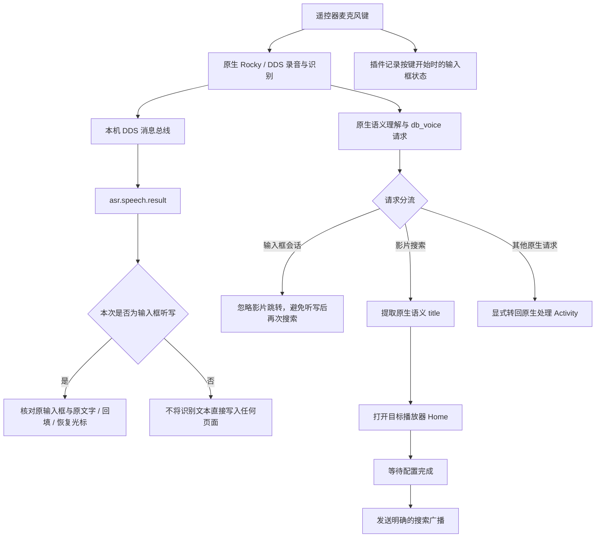

# 技术路线

## 数据流



插件不替代原生 ASR。它不调用自己的录音器、不把语音送到另一个云服务，也不复制厂商 SDK 的认证信息。

## 场景在按下时确定

是否处于输入模式，以麦克风按下时的输入框为准。完成回填后仍保留短暂的输入会话标记，避免稍后到达的原生影片语义请求被当成第二次“打开播放器搜索”。

普通输入框采用 Android 无障碍节点的 `ACTION_SET_TEXT`，保留光标插入位置或选区。回填前重新核对节点、窗口和已有文字，避免覆盖用户新输入的内容。密码框不回填。自绘输入框、不可访问的网页控件等需要单独适配。

导出的 URI 接收 Activity 不接受听写文字，防止普通深链直接写入输入框。听写仅来自已经接入的本机原生识别订阅。设备上的其他受信任应用及原生 DDS 服务本身仍属于设备的信任边界；本项目不为厂商原本无认证的本机消息总线补造安全保证。

## 原生消息协议

当前 Rocky / DDS 档案使用回环地址 `127.0.0.1:50001`。Java 客户端只连接回环地址，不监听网络端口。

帧由若干字段组成，每个字段为十进制 UTF-8 **字节长度**、CRLF、字节内容、CRLF；空行结束整个帧。步骤是：

1. `request /bus/join <唯一客户端名>`，等待 `response`。
2. `request /bus/subscribe asr.speech.result asr.speech.text sys.dialog.error`，等待 `response`。
3. 接收 `publish <topic> <JSON>`，只取需要的识别字段。

**不能省略 join。** 测试发现，旧 DDS 固件可能因未加入的客户端直接订阅而触发自身 Lua 异常。探测器因此必须完成握手后再订阅，错误即停止，不扫描其他服务或反复发送未知命令。

最终版本不发送 `asr.ctrl start/stop`，也不在按下麦克风后强行关闭原生对话。早期实验中这类控制与原生按键流程竞争，导致只能成功一次、后续一直等待。

## 语义 title 与原始句子

“我想看熊出没”的语音文本可能是完整六个字。原生影片语义请求通常包含：

```json
{
  "event": "rocky_video_search",
  "input": "我想看熊出没",
  "originalData": "{\"dm\":{\"command\":{\"param\":{\"title\":\"熊出没\"}}}}"
}
```

优先使用 `originalData.dm.command.param.title`，缺失时才使用顶层 title 或有限的前缀剥离。只处理 `rocky_video_search`，其他 URI 通过显式组件转回原处理程序，避免递归进入插件。

## 接收 Activity 必须独立任务

原生搜索请求带有清空任务相关标志。若接收 Activity 与当前输入界面共享 task affinity，可能在正确回填后把当前页面清空，表现为返回桌面。

接收器因此采用 `taskAffinity=""`、`singleInstance`、透明主题和立即 finish。项目包含对原始问题的记录，不将“能收到 URI”误当成完整流程已验证。

## K1 Pro 的 BLE 输入路由

这台设备的遥控器麦克风由固件声明的 `ble_audio` 输入提供。错误地落到不存在的内置麦克风时，AudioRecord 仍会返回数据，但采样全为零。离线识别器收到的其实是静音，换模型不能解决。

专用 workaround 仅限 `Android 9 + marconi + HQK1Pro`。部署时由授权 ADB shell 从这台设备的 `IAudioService.Stub` 读取事务号，再把它存入插件配置。插件还会在运行时再次核对板型，绝不在候选设备上应用此逻辑。

这里登记的是输入设备，不改扬声器输出；不操作 hidraw 权限，不修改系统分区或 SELinux。恢复时，如该输入原本不存在，会撤销此次登记。

## 发布版与原设备版

原设备方案使用私有包名 `com.local.voiceinput`。公开框架使用独立包名，增加配置接收器、设备档案、检测与回滚。用户的桌面、壁纸、个人备份和影视源都不进入公开项目。

公开配置接收器需要系统 `DUMP` 权限，仅供 ADB shell / 系统管理身份使用；普通第三方应用不能更改目标播放器和部署配置。
