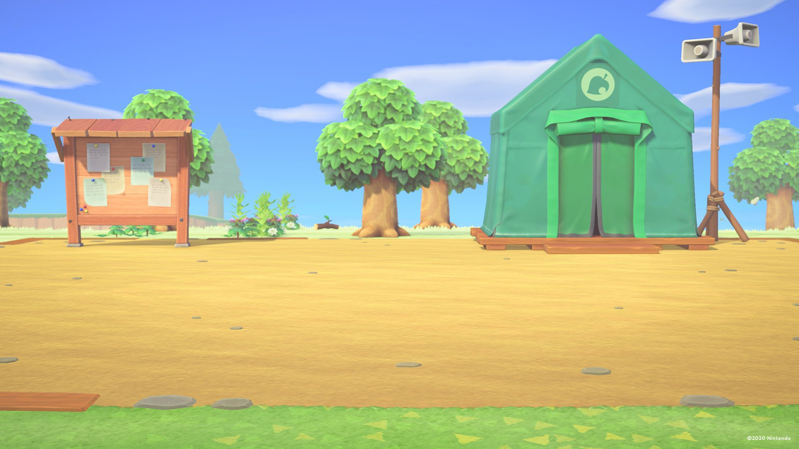

# Nintendo 桌面与屏保图集

这是本次投影仪实际使用的 **11 张 JPG**，默认每 5 分钟顺序轮换，桌面与时钟屏保共用同一组图片。已排除此前移除的动森博物馆图片，编号因此保留空缺。

| 文件 | 主题 |
| --- | --- |
| [01.jpg](images/01.jpg) | 动森 · 无人岛广场 |
| [03.jpg](images/03.jpg) | 动森 · 狸克欢迎 |
| [04.jpg](images/04.jpg) | 马里奥赛车 · 烟花夜赛 |
| [05.jpg](images/05.jpg) | 马里奥奥德赛 · 沙之国 |
| [06.jpg](images/06.jpg) | 马里奥奥德赛 · 料理国 |
| [07.jpg](images/07.jpg) | 碧姬公主 · 表演时刻 |
| [08.jpg](images/08.jpg) | 罗莎塔与琪琪 |
| [09.jpg](images/09.jpg) | 黛西公主 |
| [10.jpg](images/10.jpg) | 耀西 · 手工世界 |
| [11.jpg](images/11.jpg) | 西施慧 · 薄荷绿 |
| [12.jpg](images/12.jpg) | 西施慧 · 庆典 |

来源与署名见 [manifest.json](manifest.json)。部分原始 PNG 等图片已转换为电视使用的 JPG。图片版权归任天堂及相应作者，不适用本项目代码的 MIT License；来源署名不代表另行获得再分发或商用许可，使用时请遵循来源条款。

更换方法见 [壁纸与屏保部署说明](../../docs/wallpapers.md)。
